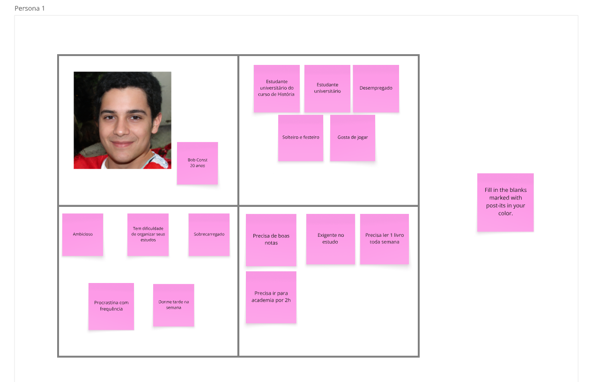
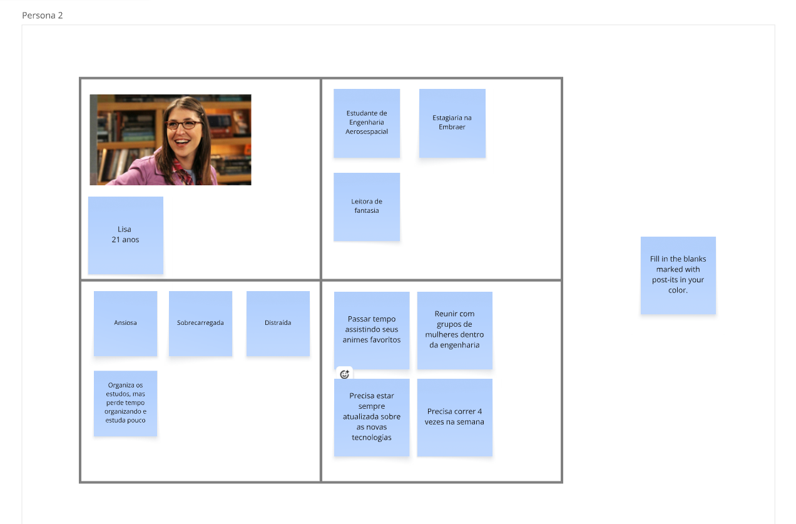
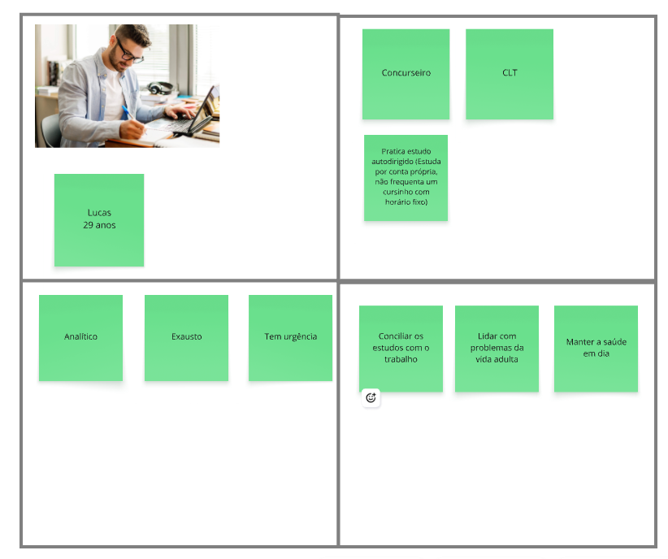
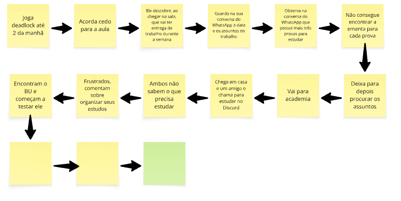
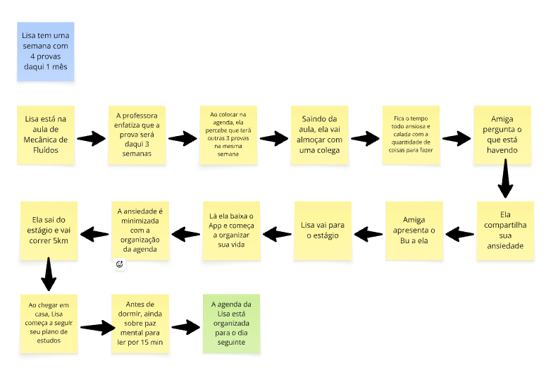
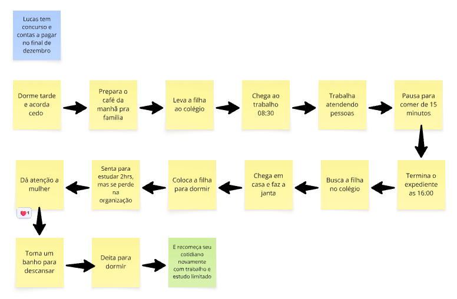

# Personas

## Persona 1: Bob Const, o Universitário Procrastinador de Alta Demanda {: #PE01 }

- **Idade:** 20 anos
- **Ocupação:** estudante universitário do curso de História (desempregado)
- **Perfil e estilo de vida:** solteiro, festeiro e entusiasta de jogos eletrônicos. Costuma dormir tarde durante os dias de semana para jogar e sair com amigos.

Perfil comportamental e psicológico:

- Ambicioso e com alto nível de exigência nos estudos.
- Costuma procrastinar com frequência.
- Encontra-se frequentemente sobrecarregado pela dificuldade de gerenciar seu próprio tempo.

Objetivos e rotina:

- Obter boas notas e manter um bom rendimento acadêmico.
- Cumprir uma rotina intensa de leitura de pelo menos 1 livro por semana exigida pelo curso.
- Manter a frequência diária de 2 horas de treino na academia.

Principais dores:

- Dificuldade severa em organizar os estudos e manter consistência na rotina.
- Conflito entre a rotina social/jogos e as altas exigências acadêmicas, gerando noites mal dormidas e sobrecarga.

## Persona 2: Lisa, a Estudante de Engenharia Sobrecarregada com Planejamento {: #PE02 }

- **Idade:** 21 anos
- **Ocupação:** estudante de Engenharia Aeroespacial e estagiária na Embraer
- **Perfil e estilo de vida:** leitora de fantasia, fã de animes e engajada socialmente na universidade através de grupos de mulheres na engenharia.

Perfil comportamental e psicológico:

- Ansiosa, distraída e sobrecarregada pelo volume de demandas intelectuais e profissionais.
- Tende a gastar energia excessiva no planejamento: organiza os estudos em detalhes, mas acaba perdendo tanto tempo organizando que sobra pouco tempo para o estudo efetivo.

Objetivos e rotina:

- Conciliar a grade curricular pesada de Engenharia Aeroespacial com a carga horária de estágio.
- Estar constantemente atualizada sobre novas tecnologias e tendências do setor.
- Manter atividades físicas regulares (correr 4 vezes por semana).
- Preservar momentos de lazer com animes e encontros da rede de mulheres.

Principais dores:

- "Paralisia por organização": o ato de estruturar o cronograma se torna um obstáculo para a execução prática dos estudos.
- Dificuldade em priorizar tarefas entre estudos técnicos, estágio corporativo e bem-estar físico.

## Persona 3: Lucas, o Concurseiro Autodidata Trabalhador {: #PE03 }

- **Idade:** 29 anos
- **Ocupação:** profissional CLT e concurseiro
- **Perfil e estilo de vida:** adulto autônomo, analítico e focado em mudar de carreira através do serviço público, estudando por conta própria (sem cursinho com horário fixo).

Perfil comportamental e psicológico:

- Extremamente analítico e pragmático.
- Exausto pela dupla jornada, carregando um senso contínuo de urgência para ser aprovado.

Objetivos e rotina:

- Conciliar uma jornada formal de trabalho (CLT) com cronogramas autodidatas de estudo para concursos públicos.
- Gerenciar as obrigações e imprevistos da vida adulta sem comprometer o tempo de estudo.
- Cuidar da saúde física e mental para evitar o esgotamento.

Principais dores:

- Escassez crítica de tempo diário e alto nível de fadiga mental acumulada.
- Falta de estrutura pré-definida de um cursinho presencial, exigindo alto esforço para manter um plano de estudos autodidata eficiente e flexível.

## Métodos de Coleta de Dados

- **Questionários quali-quantitativos (surveys online):** formulários voltados a estudantes de graduação e pessoas que estudam para concursos públicos, levantando hábitos diários, horas dedicadas ao estudo versus trabalho/lazer, tempo médio de sono e principais gargalos de produtividade.
- **Entrevistas em profundidade semiestruturadas:** conversas individuais focadas em entender a rotina real dos participantes, mapeando ferramentas de organização atualmente utilizadas, sentimentos de sobrecarga e gatilhos de distração ou abandono de cronogramas.
- **Mapeamento de empatia e dinâmicas em post-its (brainwriting):** sistematização visual dos padrões observados durante as entrevistas, consolidando dados sociodemográficos, aspirações, rotinas de saúde/lazer e dores relatadas em sessões de alinhamento com a equipe.

## Jornadas

Jornadas construídas em post-its a partir das personas. Cada imagem é acompanhada da sequência em texto.

### JO01 - Bob: descobrindo o BU {: #JO01 }

**Persona:** [Bob](#PE01)

1. Joga deadlock até 2 da manhã.
2. Acorda cedo para a aula.
3. Ele descobre, ao chegar na sala, que vai ter entrega de trabalho durante a semana.
4. Guarda na sua conversa do WhatsApp a data e os assuntos do trabalho.
5. Observa na conversa do WhatsApp que possui mais três provas para estudar.
6. Não consegue encontrar a ementa para cada prova.
7. Deixa para depois procurar os assuntos.
8. Vai para a academia.
9. Chega em casa e um amigo o chama para estudar no Discord.
10. Ambos não sabem o que precisa estudar.
11. Frustrados, comentam sobre organizar seus estudos.
12. Encontram o BU e começam a testar ele.
13. Bob cadastra as três provas e a entrega do trabalho, além da academia e das aulas como compromissos fixos, e o BU monta o ciclo semanal de estudos com as sessões de cada matéria.
14. O BU coloca os assuntos mais pesados nos horários em que Bob rende mais, deixa as leituras leves para os momentos de baixa energia e explica em linguagem simples por que sugeriu cada sessão.
15. **Desfecho:** Bob vai dormir num horário razoável, sabendo o que vai estudar no dia seguinte. Se perder uma sessão, o BU recalcula a rotina sem culpa, e ele passa a cumprir o ciclo semanal sem abrir mão da academia e da vida social.

!!! warning "Pendente"
    Os passos 13 a 15 completam os três post-its que estavam em branco no material-base (a imagem acima ainda os mostra vazios) e são uma proposta para validação do grupo.

### JO02 - Lisa: semana com 4 provas daqui 1 mês {: #JO02 }

**Persona:** [Lisa](#PE02)

1. Lisa está na aula de Mecânica de Fluidos.
2. A professora enfatiza que a prova será daqui 3 semanas.
3. Ao colocar na agenda, ela percebe que terá outras 3 provas na mesma semana.
4. Saindo da aula, ela vai almoçar com uma colega.
5. Fica o tempo todo ansiosa e calada com a quantidade de coisas para fazer.
6. Amiga pergunta o que está havendo.
7. Ela compartilha sua ansiedade.
8. Amiga apresenta o BU a ela.
9. Lisa vai para o estágio.
10. Lá ela baixa o App e começa a organizar sua vida.
11. A ansiedade é minimizada com a organização da agenda.
12. Ela sai do estágio e vai correr 5 km.
13. Ao chegar em casa, Lisa começa a seguir seu plano de estudos.
14. Antes de dormir, ainda sobre paz mental para ler por 15 min.
15. **Desfecho:** a agenda da Lisa está organizada para o dia seguinte.

### JO03 - Lucas: concurso e contas no final de dezembro {: #JO03 }

**Persona:** [Lucas](#PE03)

1. Dorme tarde e acorda cedo.
2. Prepara o café da manhã pra família.
3. Leva a filha ao colégio.
4. Chega ao trabalho 08:30.
5. Trabalha atendendo pessoas.
6. Pausa para comer de 15 minutos.
7. Termina o expediente às 16:00.
8. Busca a filha no colégio.
9. Chega em casa e faz a janta.
10. Coloca a filha para dormir.
11. Senta para estudar 2 h, mas se perde na organização.
12. Dá atenção à mulher.
13. Toma um banho para descansar.
14. Deita para dormir.
15. **Desfecho:** e recomeça seu cotidiano novamente com trabalho e estudo limitado.

!!! note "Contexto"
    Contexto da jornada: Lucas tem concurso e contas a pagar no final de dezembro.
