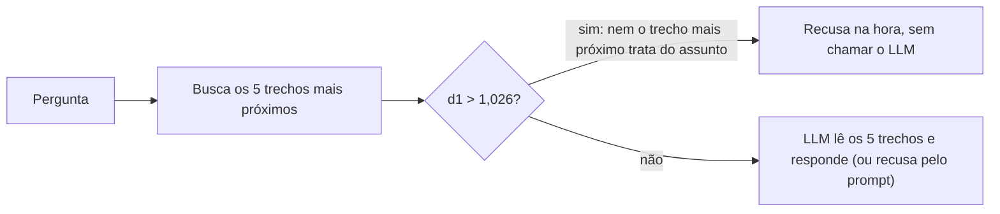

# 4. Implementação: T3 + porteiro no notebook

A [Decisão](03-decisao.md) escolheu o **T3 + porteiro**: RAG + LLM com k=5, o prompt original do notebook e um porteiro de distância que recusa antes de chamar o LLM. Este capítulo explica o que mudou no `rag_pipeline_semana2.ipynb`, por que cada mudança foi feita, como o porteiro funciona e quais são os limites dele.

## O que mudou no notebook

| | Antes (Semana 2) | Agora (Semana 3) | Por quê |
| :-- | :-- | :-- | :-- |
| Trechos entregues ao LLM | `TOP_K = 3` | **`TOP_K = 5`** | Completude de 0,81 para 0,91, e de 0,53 para 0,87 nas perguntas multi-fonte ([cap. 8](../08-geracao-e-llm-juiz.md)) |
| Recusa de perguntas fora de escopo | Só pelo prompt (o LLM lê e decide) | **Porteiro de distância** antes do LLM; o prompt continua como segunda barreira | Barra 6 de 10 perguntas fora de escopo em 0,14 s, sem chamar o LLM, e não recusa nenhuma pergunta válida |
| Prompt do LLM | `RAG_SYSTEM_PROMPT` | **Igual** | O prompt revisado do T4 derrubou a completude de 0,91 para 0,76 ([Resultados › T4](02-resultados.md#t4--rag--llm-otimizado-o-que-mudou)) |
| Saída da chain | `question`, `context_docs`, `answer` | As mesmas, mais **`d1`** e **`barrada_pelo_porteiro`** | Deixa visível por que cada pergunta foi ou não recusada |
| Demonstração | 3 perguntas das personas | As 3 personas + **1 pergunta fora de escopo** | Mostra o porteiro funcionando |

O resto do pipeline (base, chunking de 500 com overlap de 50, embeddings, ChromaDB, LLM) não mudou.

## Como o porteiro funciona

Toda busca no ChromaDB devolve, junto com cada trecho, uma **distância** até a pergunta. Quanto menor a distância, mais o trecho fala do mesmo assunto. O porteiro olha só um número, a distância do trecho **mais próximo** ($d_1$):



A ideia: se **nem o trecho mais parecido** da base está perto da pergunta, nenhum outro estará, e não adianta pagar uma chamada ao LLM para ele concluir o óbvio. É uma regra simples, sem IA, que roda em milissegundos.

No código (célula da chain), o porteiro é a função `recuperar_com_porteiro`. Ela busca os `TOP_K` trechos, calcula `d1` e marca `barrada_pelo_porteiro`. A função `responder` devolve a frase de recusa quando a pergunta foi barrada e chama o LLM nos outros casos. A frase de recusa é **a mesma** do prompt, então, para quem usa, uma recusa do porteiro e uma do LLM são iguais.

## De onde vem o corte de 1,026

O corte é o ponto mais delicado. Se ele ficar baixo demais, o sistema recusa perguntas válidas. Se ficar alto demais, não barra nada.

**Não escolhemos o corte olhando a prova.** Ajustar o número para acertar as 28 perguntas de teste seria como decorar o gabarito: o resultado ficaria perfeito na prova e falharia com perguntas novas. O corte foi calibrado com dados **que não entram na avaliação**: as 36 paráfrases das perguntas válidas (as `variacoes` do gabarito, escritas como um estudante escreveria).

$$
\tau = \max_{v \,\in\, \text{paráfrases}} d_1(v) = 1{,}026
$$

Ou seja, o corte é a distância da paráfrase válida **mais distante**. Assim, nenhuma das 36 é recusada. Só depois de fixar o corte olhamos onde caem as 28 perguntas de teste:

| Grupo | $d_1$ | Com o corte de 1,026 |
| :-- | :-- | :-- |
| 18 perguntas válidas | 0,52 a 0,90 | Nenhuma recusada ✓ |
| 6 fora de escopo (ações, salário, Bhaskara, Python, Austrália, pedir aumento) | 1,03 a 1,47 | Barradas antes do LLM ✓ |
| 4 fora de escopo "perigosas" (café, emagrecer, cadeira, remédio para dormir) | 0,92 a 1,01 | Passam e são recusadas pelo LLM ✓ |

As 4 que passam são parecidas com o tema da base (concentração, sono, rotina de estudo). Por isso, **o porteiro não substitui o prompt**: ele é uma primeira barreira barata, e a instrução "se não estiver no contexto, recuse" continua sendo a segunda. No T3, o prompt recusou as 10 perguntas fora de escopo, inclusive essas 4.

> **Por que aceitar que 4 passem?** Porque o erro contrário é pior. Recusar uma pergunta válida frustra o estudante e não tem conserto; deixar passar uma fora de escopo só custa uma chamada ao LLM, que ainda pode recusá-la. O corte foi posto do lado seguro.

Para recalcular o corte (por exemplo, depois de mudar a base ou o gabarito), a partir de `pesquisa/`:

```bash
../.venv/bin/python -m metricas.comparacao.modos calibrar
```

O resultado fica em `metricas/relatorios/comparacao_porteiro.json`.

## O corte só vale para o bge-m3

Cada modelo de embedding mede distância numa **escala própria**, como réguas em unidades diferentes. Um 1,026 do `bge-m3` não quer dizer nada para os embeddings do Gemini, da OpenAI ou para o embedding offline do notebook. Usar o mesmo corte com outro modelo poderia recusar tudo ou não recusar nada.

Por isso o notebook só liga o porteiro quando conhece o corte do embedding ativo:

| Embedding ativo | Porteiro |
| :-- | :-- |
| `bge-m3` (Ollama, `EMBEDDING_PROVIDER=ollama`) | **Ligado**, corte de 1,026 |
| Gemini, OpenAI, `qwen3-embedding` ou o embedding offline | **Desligado**, com um aviso no log. A recusa fica só com o prompt, como era antes |

Se alguém trocar o embedding e quiser o porteiro, basta recalibrar com o comando acima e passar o novo valor em `PORTEIRO_TAU`.

## Como configurar

Tudo continua funcionando com os valores padrão. As variáveis de ambiente (no `api/.env` ou no terminal) só servem para experimentos:

| Variável | Padrão | Efeito |
| :-- | :-- | :-- |
| `TOP_K` | `5` | Quantos trechos vão para o LLM |
| `PORTEIRO_TAU` | o corte calibrado do embedding ativo (1,026 no `bge-m3`) | Um número troca o corte. `desligado` desliga o porteiro |
| `EMBEDDING_PROVIDER` | o mesmo do LLM | `ollama` usa o `bge-m3` local |
| `LLM_PROVIDER` | o detectado pelas chaves do `.env` | `ollama` usa o `qwen3:8b` local |

Para repetir as rodadas antigas do [cap. 8](../08-geracao-e-llm-juiz.md) exatamente como eram, use `TOP_K=3 PORTEIRO_TAU=desligado`.

## Como foi verificado

Executamos a chain do notebook de ponta a ponta, com `bge-m3` e `qwen3:8b` locais:

| Pergunta | $d_1$ | O que aconteceu | Tempo |
| :-- | :-- | :-- | :-- |
| "Como funciona a técnica Pomodoro?" (válida) | 0,517 | Segue para o LLM, que responde com 5 trechos e cita a fonte | 20,4 s |
| "Qual a capital da Austrália?" (fora de escopo) | 1,466 | **Barrada pelo porteiro**, sem chamar o LLM | 0,12 s |
| "Quanto café posso tomar para me concentrar?" (fora de escopo, "perigosa") | 0,931 | Passa pelo porteiro; **o LLM recusa** | 4,4 s |

As distâncias são idênticas às da calibração, o que confirma que o notebook usa o mesmo índice medido no experimento. A demonstração das personas foi executada de novo e salva no notebook: as 3 perguntas válidas seguem para o LLM ($d_1$ de 0,72 a 0,82) e a pergunta sobre ações é barrada ($d_1$ = 1,169).

Também conferimos a escolha do corte: com `bge-m3` ele é 1,026; com Gemini, `qwen3-embedding` ou o embedding offline, o porteiro fica desligado; `PORTEIRO_TAU=desligado` desliga, e um número o substitui.

## O que esta mudança não resolve

- **A diluição da q12 continua.** O k=5 ainda faz o LLM perder "defina quando, onde e como" nessa pergunta. A correção proposta é testar só a regra 3 do prompt do T4, sem a regra 5 ([Decisão › Próximos passos](03-decisao.md#próximos-passos)).
- **O "T3 + porteiro" ainda não foi medido como um teste próprio.** Os números dele foram deduzidos de T3 e T4 (válido, porque o porteiro não barrou nenhuma pergunta válida). Agora que ele está no notebook, dá para medi-lo diretamente com `python -m metricas.geracao.runner`.
- **O corte foi calibrado com paráfrases escritas pelo grupo**, não por estudantes reais. Com uso real, ele pode precisar de ajuste.
- **O código de métricas passa a usar o pipeline novo.** O `metricas/geracao/runner.py` roda a chain do notebook, então as próximas rodadas já saem com k=5 e porteiro (a configuração usada fica registrada no JSON, em `porteiro_tau` e `top_k`). Os testes T1 a T4 do `metricas/comparacao/` não mudam: eles montam cada configuração de forma explícita.
