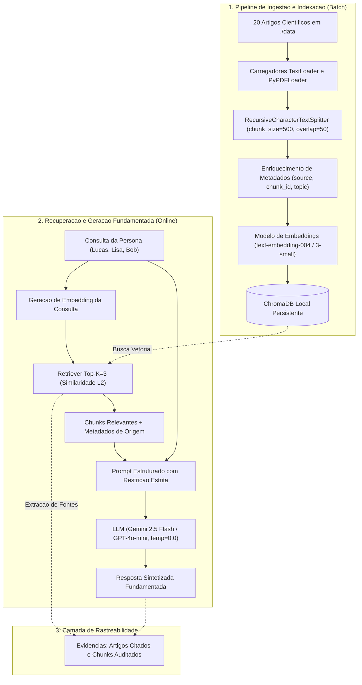

# Arquitetura da Solucao — Pipeline RAG

Esta pagina descreve a arquitetura tecnica do mecanismo RAG (*Retrieval-Augmented Generation*) desenvolvido para a orientacao de rotinas de estudo e preparacao técnica.

---

## 1. Visao Geral

O sistema desacopla o processo de indexacao e preparacao de dados do processo de consulta e sintese em tempo real:

1. **Pipeline de Ingestao (Offline / Batch):** Leitura de documentos brutos, normalizacao de texto, particionamento semantico (*chunking*), enriquecimento de metadados, calculo de vetores densos (*embeddings*) e gravacao indexada no banco vetorial. [implementado]
2. **Pipeline de Recuperacao e Inferencia (Online / Real-time):** Conversao da pergunta do usuario em vetor denso, recuperacao dos fragmentos mais proximos via distancia Euclidiana ($L_2$), montagem de prompt contextualizado com regras estritas de *grounding*, e geracao de resposta auditavel via LLM. [implementado e testado]

---

## 2. Diagrama de Arquitetura

O diagrama abaixo ilustra o fluxo de dados entre os componentes do sistema:

---

## 3. Especificacao dos Componentes

### 3.1. Base de Conhecimento Curada
- **Status:** Implementado.
- **Localizacao:** Diretorio `./data/` do projeto principal.
- **Composicao:** 20 artigos cientificos em formato `.txt`, organizados em 4 blocos tematicos:
  1. *Retencao e Neurociencia:* Karpicke & Roediger (2008), Cepeda et al. (2006), Rohrer & Taylor (2007), Sweller (2005) e Walker (2009).
  2. *Foco e Produtividade:* Newport (2016), Leroy (2009), Gollwitzer (1999), Allen & Pozen (2012) e Cirillo (2006).
  3. *Comportamento e Procrastinacao:* Steel (2007), Flett & Hewitt (2002), Wood & Rünger (2016), Baumeister et al. (1998) e Bandura (1977).
  4. *Planejamento Autodidata e Editais:* Box et al. (1987), Meirelles & Perez (2015), Thomas (2000), Martins & Silveira (2020) e Gleick & Goodstein (1992).

### 3.2. Camada de Ingestao e Segmentacao
- **Status:** Implementado.
- **Carregadores:** `TextLoader` com decodificacao UTF-8 tolerante a erros e `PyPDFLoader` para suporte a documentos complementares em PDF.
- **Segmentador:** `RecursiveCharacterTextSplitter` configurado com `chunk_size = 500` caracteres e `chunk_overlap = 50` caracteres (10% de margem).

### 3.3. Persistencia Vetorial (ChromaDB)
- **Status:** Implementado e persistido em disco.
- **Engine:** ChromaDB local no diretorio `./chroma_db`, sob a colecao `residencia_ia_semana2`.
- **Indice Vetorial:** Algoritmo HNSW (*Hierarchical Navigable Small World*) com busca por Distancia Euclidiana ($L_2$).
- **Idempotencia:** O carregador remove IDs preexistentes antes de reinserir, evitando fragmentos duplicados em execucoes repetidas.

### 3.4. Camada de Recuperacao e Chain RAG
- **Status:** Implementado e testado.
- **Orquestracao:** LangChain Expression Language (LCEL) com execucao paralela (`RunnableParallel`) para manter os documentos recuperados e a pergunta no dicionario de saida.
- **Retriever:** Configuracao de `similarity_search_with_score` com parametro `k = 3`.
- **Politica de Grounding:** Prompt restritivo de sistema com temperatura `0.0`. Caso o contexto seja insuficiente, o modelo emite a recusa padrao: *"Nao encontrei informacoes suficientes na base de conhecimento para responder a essa pergunta."*

### 3.5. Auditoria e Rastreabilidade
- **Status:** Implementado e verificado.
- A formatacao de contexto injeta explicitamente `[Fonte: <arquivo> | Chunk ID: <id>]`, permitindo verificar diretamente o documento e o paragrafo exato de onde o LLM derivou cada afirmacao.

---

!!! info "Decisao Arquitetural: ChromaDB Local"
    Optou-se pelo ChromaDB embutido no processo Python nesta etapa por eliminar a necessidade de servidores ou bancos gerenciados em nuvem, mantendo a execucao totalmente reproduzivel localmente e sem custos adicionais de infraestrutura.
