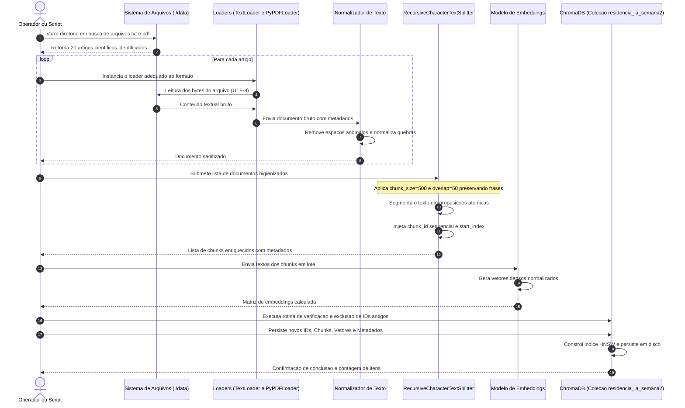

# Pipeline de Ingestao de Dados

Esta pagina detalha o fluxo de extracao, transformacao e carga (*ETL*) responsavel por converter os 20 documentos cientificos brutos em vetores semanticos indexados e auditaveis no banco vetorial.

---

## 1. Visao Geral do Pipeline

O pipeline de ingestao opera sob os seguintes principios operacionais:

- **Resiliencia:** Processamento individual de arquivos sob blocos de protecao contra falhas, permitindo que eventuais erros de leitura em um documento nao interrompam o processamento dos demais. [implementado]
- **Idempotencia:** Rotina de limpeza previa de identificadores na colecao antes de indexar, garantindo que reexecucoes nao gerem fragmentos duplicados. [implementado]
- **Linhagem de Dados (*Data Lineage*):** Preservacao de metadados de origem em cada fragmento gerado para rastreabilidade ponta a ponta. [implementado]

---

## 2. Diagrama de Sequencia da Ingestao



---

## 3. Etapas do Processamento

### Etapa 1: Descoberta de Fontes
- O script varre o diretorio configurado (padrao: `./data/`).
- Identifica extensoes validas (`.txt` e `.pdf`), ignorando arquivos temporarios ou ocultos do sistema operacional.
- Emite aviso em log caso o diretorio nao exista ou esteja vazio, acionando a rotina de contingencia com base sintetica em memoria.

### Etapa 2: Carga Tolerante a Falhas
- Utiliza `TextLoader` com decodificacao `utf-8` e estrategia de substituicao de caracteres (`errors='replace'`).
- Utiliza `PyPDFLoader` caso arquivos PDF sejam adicionados a base.
- Cada documento e lido dentro de bloco `try/except` individual; arquivos com erro sao registrados em log sem interromper o restante do lote.

### Etapa 3: Higienizacao Textual
- Normalizacao de caracteres em branco repetidos e quebras de linha irregulares.
- Preservacao integral dos cabecalhos bibliograficos (TITULO, AUTORES, TEMA) presentes no topo de cada artigo cientifico.

### Etapa 4: Segmentacao Semantica
- Instanciacao do `RecursiveCharacterTextSplitter` com a hierarquia de corte:
  ```python
  separators = ["\n\n", "\n", ". ", " ", ""]
  ```
- O particionamento respeita as fronteiras semanticas, separando o cabecalho contextual do corpo do artigo sem quebras no meio de sentencas.

### Etapa 5: Enriquecimento de Metadados
Cada fragmento gerado recebe um conjunto de metadados padronizados:
- `source`: Caminho relativo do arquivo (ex.: `data/artigo_01_active_recall_karpicke.txt`).
- `chunk_id`: Indice sequencial do fragmento dentro do documento (ex.: `0`, `1`).
- `topic`: Rotulo tematico inferido a partir do cabecalho do documento.
- `start_index`: Posicao inicial do caractere no texto original.

### Etapa 6: Vetorizacao e Indexacao Idempotente
- Os textos dos fragmentos sao submetidos ao modelo de embeddings selecionado.
- Antes da insercao, a colecao `residencia_ia_semana2` e consultada: caso existam registros associados aos mesmos IDs, eles sao expurgados previamente para evitar duplicatas.
- Os vetores densos e os metadados sao gravados no ChromaDB e persistidos no disco local (`./chroma_db`).

---

!!! warning "Contingencia Offline"
    Caso o operador execute o pipeline sem credenciais de API ativas (OpenAI ou Google), o sistema aciona automaticamente a classe `LocalKeywordHashEmbeddings`, gerando vetores determinísticos em 256 dimensoes baseados em n-grams de palavras. Isso viabiliza testes de integracao e execucoes locais sem custos.
